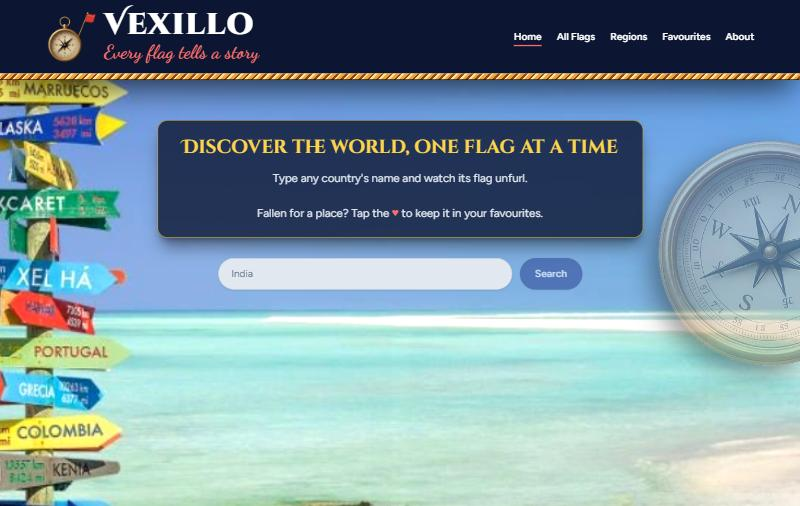
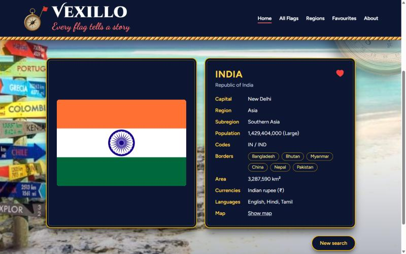
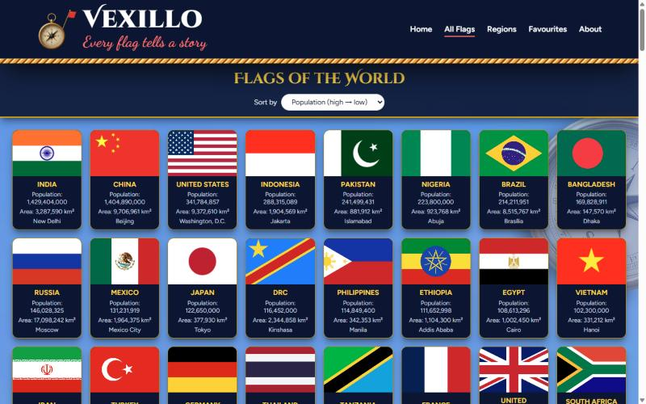
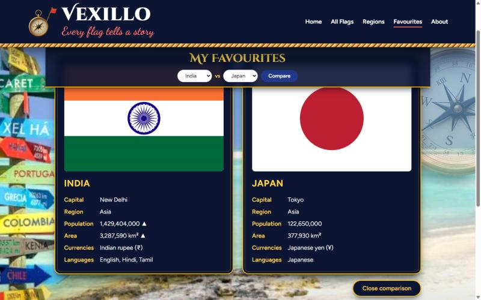
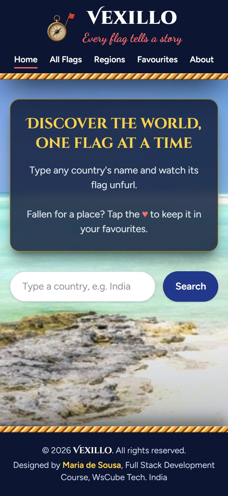

# Vexillo

### *Every flag tells a story*

A world explorer for flags and country facts. 
Search any country, browse every flag, filter by region, save favourites and compare two countries side by side.

---

## About

**Vexillo** comes from the Latin *vexillum*, the cloth banner carried by Roman soldiers, and the root of *vexillology*, the study of flags. Every flag is a small story of a nation: its history, its hopes and its people.

Built as my **Milestone 2 project (JavaScript Mastery)** for the Full Stack Development Course at **WsCube Tech**, using HTML, Tailwind CSS and vanilla JavaScript, with live data from the REST Countries API.

---

## Features

| | Feature | What it does |
| :---: | --- | --- |
| 🔎 | **Search** | Up to 6 name suggestions as you type. Only an exact name is accepted; a typo opens a friendly *Country not found* popup. |
| 🏳️ | **Country details** | Flag, official name, capital, region, subregion, population (Small / Medium / Large), codes, area, currencies and languages. |
| 🧭 | **Border chips** | Click a neighbouring country to jump straight to its details. |
| 🗺️ | **Map** | *Show map* opens a Google Map inside the details card. |
| 🌍 | **All Flags** | Every country's flag in a grid, sortable by name, population or area. |
| 🌐 | **Regions** | Africa, Americas, Antarctic, Asia, Europe or Oceania, with the same sorting. |
| ❤️ | **Favourites** | Tap the heart to save a country. Saved in the browser, so they stay after a refresh. |
| ⚖️ | **Compare** | Two favourites side by side. A ▲ marks the bigger population and area. |
| 📱 | **Responsive** | 2, 4, 6 or 8 flags per row, from phone to large screen. |

---

## Screenshots

<table>
  <tr>
    <td align="center" valign="top" width="50%"><b>Search result</b>  </td>
    <td align="center" valign="top" width="50%"><b>All Flags, sorted by population</b>  </td>
  </tr>
  <tr>
    <td align="center" valign="top" width="50%"><b>Compare two favourites</b>  </td>
    <td align="center" valign="top" width="50%"><b>On a phone</b>  </td>
  </tr>
</table>

---

## How It Works

Everything runs in the browser. `index.html` holds the page and its four views (Home, All Flags, Regions, Favourites), `app.js` fetches the data and builds the page, and `countries-backup.js` is the back-up country list.

| What | REST Countries v5 endpoint | Used for |
| --- | --- | --- |
| All countries, 100 at a time | `/countries/v5?limit=100&offset=0` | Everything: search, suggestions, details, border chips, All Flags, Regions, Favourites, Compare |
| Search by name (back-up) | `/countries/v5/name?q=India` | Only if the full list could not be loaded |
| One country by code (back-up) | `/countries/v5/codes.alpha_3/IND` | Only if the full list could not be loaded |

- The full country list is loaded **once** (100 per request, the free plan's limit) while the splash screen shows, then reused by every view.
- The list is also **saved in the browser for 7 days** (`localStorage`), so a returning visitor uses no API requests at all. If the API ever refuses a request (for example the monthly limit is used up), the app falls back to the last saved list and keeps working.
- If there is no saved list either, the app uses `countries-backup.js` (a copy of the country list saved from the API), so it never shows an empty page.
- `response_fields` asks the API only for the fields the app needs.
- Favourites are saved in `localStorage` as JSON.

---

## How to Run Locally

1. Clone or download the repository (keep all the files together in one folder).
2. **Either** double-click `index.html` to open it in your browser, **or** open the folder in VS Code and right-click `index.html` → **Open with Live Server**.

That's all: no `npm install` and no API key needed. An internet connection is needed for the styling (Tailwind loads from a CDN), the fonts, the flag pictures and the map.

> **API key and the backup list:** the REST Countries key in `app.js` only works on the websites listed in its settings (`localhost`, `127.0.0.1` and the Vercel address). When the page is opened straight from the disk (`file://`), from any other address, or when the API refuses the request (for example the free plan's monthly limit is used up), Vexillo uses **`countries-backup.js`**, a saved copy of all 254 countries, so every feature still works. The only difference: *Show map* uses a Google Maps search instead of the API's map link.

---

## Author

**Maria de Sousa** 
Full Stack Development student · WsCube Tech, India

[GitHub](https://github.com/mariadesousasfx71-source) · [Live site](https://vexillo-sigma.vercel.app)

Vexillo is a course project. Country data from the REST Countries API.

