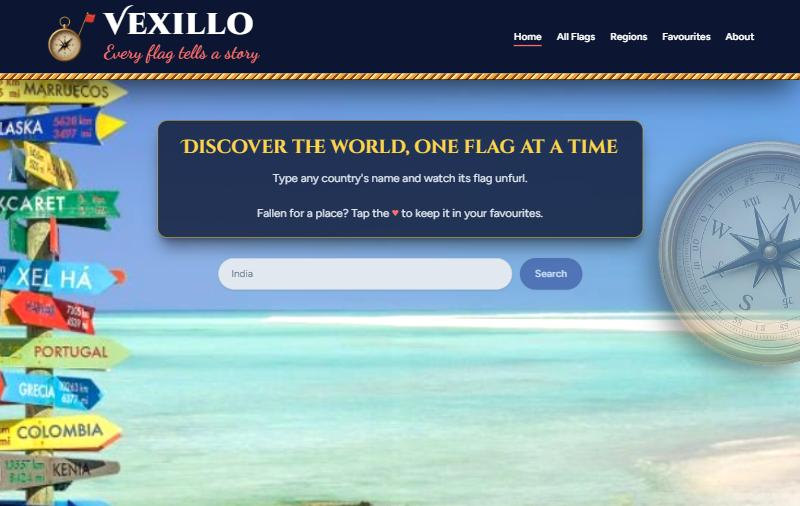
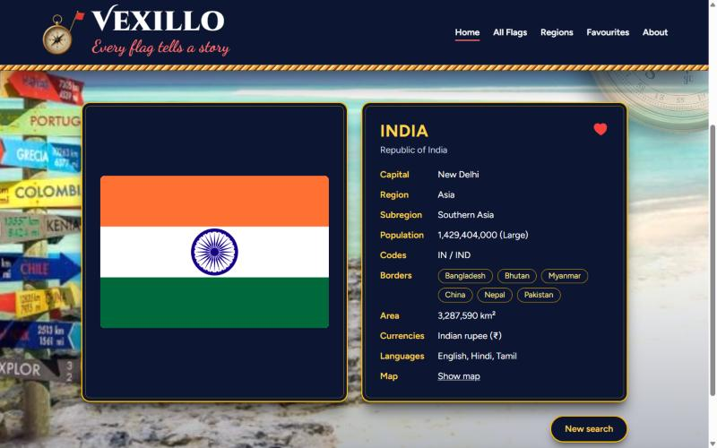
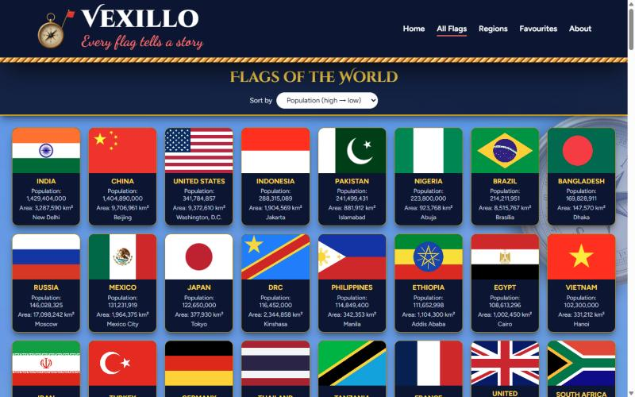
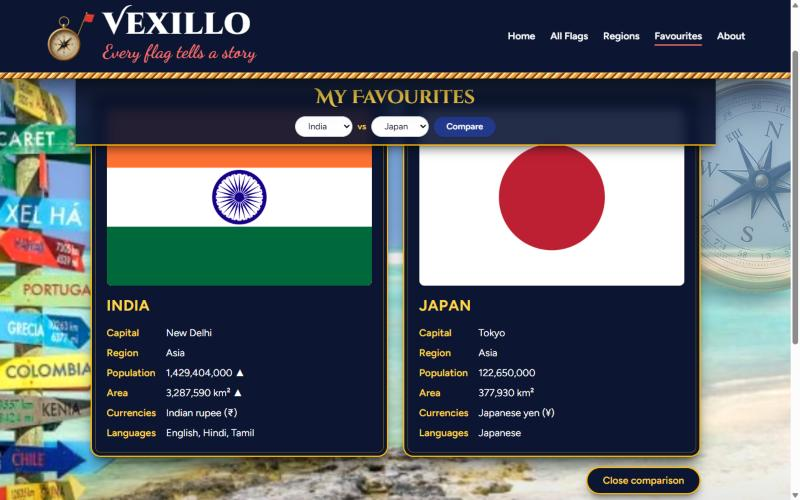
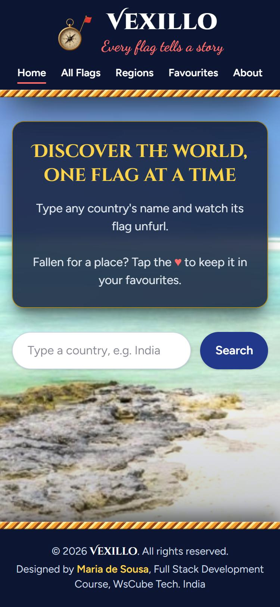

<div align="center">


# Vexillo

### *Every flag tells a story*

A world explorer for flags and country facts.<br>
Search any country, browse every flag, filter by region, save favourites and compare two countries side by side.

[](https://vexillo-sigma.vercel.app)




</div>

---

## Contents

- [About](#about)
- [Features](#features)
- [Screenshots](#screenshots)
- [How It Works](#how-it-works)
- [JavaScript Concepts Used](#javascript-concepts-used)
- [Project Structure](#project-structure)
- [How to Run Locally](#how-to-run-locally)
- [Author](#author)

---

## About

**Vexillo** comes from the Latin *vexillum*, the cloth banner carried by Roman soldiers, and the root of *vexillology*, the study of flags. Every flag is a small story of a nation: its history, its hopes and its people.

Built as my **Milestone 2 project (JavaScript Mastery)** for the Full Stack Development Course at **WsCube Tech**, using HTML, Tailwind CSS and vanilla JavaScript, with live data from the REST Countries API.

---

## Features

| | Feature | What it does |
| :---: | --- | --- |
| 🔎 | **Search** | Up to 6 name suggestions as you type. Only an exact name is accepted; a typo opens a friendly *Country not found* popup. |
| 🏳️ | **Country details** | Flag, official name, capital, region, subregion, population (Small / Medium / Large), codes, area, currencies and languages. |
| 🧭 | **Border chips** | Click a neighbouring country to jump straight to its details. |
| 🗺️ | **Map** | *Show map* opens a Google Map inside the details card. |
| 🌍 | **All Flags** | Every country's flag in a grid, sortable by name, population or area. |
| 🌐 | **Regions** | Africa, Americas, Antarctic, Asia, Europe or Oceania, with the same sorting. |
| ❤️ | **Favourites** | Tap the heart to save a country. Saved in the browser, so they stay after a refresh. |
| ⚖️ | **Compare** | Two favourites side by side. A ▲ marks the bigger population and area. |
| 📱 | **Responsive** | 2, 4, 6 or 8 flags per row, from phone to large screen. |

---

## Screenshots

<table>
  <tr>
    <td align="center" valign="top" width="50%"><b>Search result</b><br><br></td>
    <td align="center" valign="top" width="50%"><b>All Flags, sorted by population</b><br><br></td>
  </tr>
  <tr>
    <td align="center" valign="top" width="50%"><b>Compare two favourites</b><br><br></td>
    <td align="center" valign="top" width="50%"><b>On a phone</b><br><br></td>
  </tr>
</table>

---

## How It Works

Everything runs in the browser. `index.html` holds the page and its four views (Home, All Flags, Regions, Favourites), and `app.js` fetches the data and builds the page.

| What | REST Countries v5 endpoint | Used for |
| --- | --- | --- |
| Search by name | `/countries/v5/name?q=India` | The search box |
| One country by code | `/countries/v5/codes.alpha_3/IND` | Border chips, flag cards, Compare |
| All countries, 100 at a time | `/countries/v5?limit=100&offset=0` | All Flags, Regions, Favourites, instant suggestions |

- The full country list is loaded **once** (100 per request, the free plan's limit) while the splash screen shows, then reused by every view.
- `response_fields` asks the API only for the fields the app needs.
- Favourites are saved in `localStorage` as JSON.

---

## JavaScript Concepts Used

| Concept | Where |
| --- | --- |
| `fetch` + `async` / `await`, with a `res.ok` check | Every API request |
| `try` / `catch` / `finally` | Friendly errors, loaders always hidden |
| **Event delegation** | One listener for suggestions, border chips, flag grids and hearts |
| **Debouncing** (`setTimeout` / `clearTimeout`) | Suggestions while typing |
| `Promise.all` and `Promise.race` | Compare (two countries at once), splash screen limit of 15 s |
| Request ids | A slow old answer never replaces a newer one |
| `localStorage` + `JSON.stringify` / `JSON.parse` | Favourites |
| Optional chaining `?.` and `??` | Missing data never crashes the page |
| Array methods: `map`, `filter`, `find`, `some`, `sort`, `slice` | Suggestions, sorting, regions |

---

## Project Structure

```
vexillo/
├── index.html              page: header, 4 views, popups, footer
├── app.js                  all the JavaScript
└── images/
    ├── background.png      beach background
    ├── compass-logo.png    logo
    ├── compass-half.gif    animated compass (wide screens)
    ├── globe-loader.svg    spinning globe loader
    └── screenshots/        images used in this README
```

---

## How to Run Locally

1. Clone or download the repository.
2. Open the folder in VS Code.
3. Right-click `index.html` → **Open with Live Server**.

No `npm install` needed: Tailwind loads from a CDN.

> **API key:** the REST Countries key in `app.js` only works on the websites listed in its settings (localhost and the Vercel address). To run Vexillo elsewhere, create a free key at [restcountries.com](https://restcountries.com), add your site's hostname to it, and replace `API_KEY` in `app.js`. The free plan allows 1,000 requests a month.

---

## Author

<div align="center">

**Maria de Sousa**<br>
Full Stack Development student · WsCube Tech, India

[GitHub](https://github.com/mariadesousasfx71-source) · [Live site](https://vexillo-sigma.vercel.app)

<sub>Vexillo is a course project. Country data from the REST Countries API.</sub>

</div>
